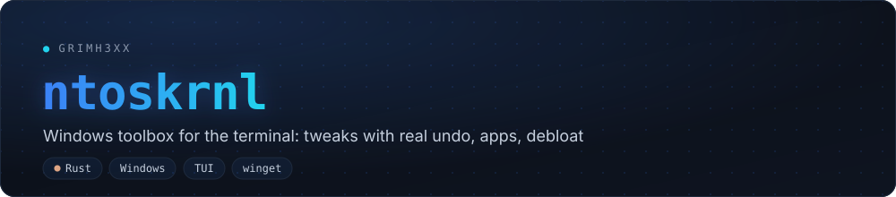
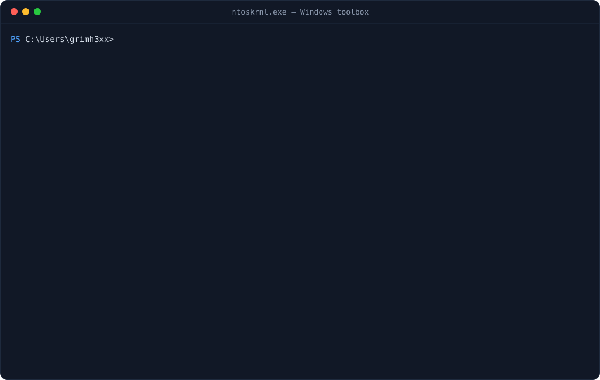

[](https://github.com/grimh3xx/ntoskrnl/actions)
[](https://github.com/grimh3xx/ntoskrnl/releases/latest)
[](LICENSE)


**A Windows toolbox for the terminal, in Rust.** One command opens a TUI with 77 tweaks,
75 apps via winget, a debloater, ready-made profiles and repair tools. Every tweak backs up
the original value before touching anything, checks that Windows actually accepted the
change, and can be undone.

<p align="center"></p>

## Quick start

**PowerShell**

```powershell
irm https://github.com/grimh3xx/ntoskrnl/releases/latest/download/install.ps1 | iex
```

**cmd**

```bat
powershell -c "irm https://github.com/grimh3xx/ntoskrnl/releases/latest/download/install.ps1 | iex"
```

[`install.ps1`](install.ps1) is 30 lines, so read it first. It downloads `ntoskrnl.exe` from the
latest release, **verifies its SHA256** against the hash published with it, and only then runs it
(asking for administrator). If the hash doesn't match, nothing runs.

The interface opens in Portuguese. Add `--lang en` for English (see [CLI](#cli)).

## Features

| | |
|---|---|
| **Tweaks** | 77 tweaks across power, gaming, GPU, input, system, network, privacy, services and security. Each one shows exactly what it changes (registry value, service or script), its risk level, and why it's blocked when it doesn't fit your PC (wrong GPU vendor, HDD instead of SSD, Windows build, laptop, Home edition, no Defender) |
| **Apps** | 75 curated apps installed through `winget`, already-installed ones marked. Batch install, or `winget upgrade --all` |
| **Debloat** | Removes preinstalled apps from a **closed list**, for every user and from the provisioned image. Nothing outside the list is removed, and nothing games depend on (Xbox Identity, Store, Game Bar) is on it |
| **Profiles** | `recomendado` · `gamer` · `privacidade` · `blindagem` · `minimo`. Tweaks that don't fit the machine are skipped automatically |
| **Repairs** | Restore point · SFC · DISM RestoreHealth · network reset · unstick Windows Update · clean temp files |
| **Drift check** | Big Windows updates silently revert some tweaks. `v` (or `ntoskrnl check --fix`) finds and reapplies them |

**Safety built in**
- The original value of every registry key and service is written to
  `%ProgramData%\ntoskrnl\state.json` **before** anything changes. Script-based tweaks ship their own backup and revert.
- After applying, ntoskrnl **reads the values back**. If Windows ignored the change (Tamper Protection,
  group policy, a driver), it rolls back and tells you, instead of reporting success.
- If something fails halfway, whatever that tweak already changed is undone.
- A restore point is created before applying (toggle with `p`).
- Every action asks for confirmation and streams its output to the **Log** tab.

**What it will not do:** turn off Defender, UAC, Spectre mitigations or VBS, download anything
outside `winget` and its own release, or send any data anywhere.

## Keys

| Key | Action |
|---|---|
| `1`–`6` · `Tab` · `←` `→` | switch tab |
| `↑` `↓` · `PgUp` `PgDn` · `g` `G` | move |
| `space` · `a` | pick · pick everything visible |
| `Enter` | apply / install / remove / run |
| `u` | undo (tweak or profile) |
| `c` · `/` · `Esc` | filter by category · search · clear |
| `p` | restore point on/off |
| `v` | check for tweaks Windows reverted |
| `U` | upgrade every app (Apps tab) |
| `q` | quit |

## CLI

With no arguments it opens the TUI. With a subcommand it runs headless, which is handy for post-install scripts:

```text
ntoskrnl [options] [command]

  list [--json]                 every tweak and its state on this PC
  apply <id>...                 apply tweaks
  revert <id>... | --all        undo
  profile <name> [--revert]     recomendado | gamer | privacidade | blindagem | minimo
  install <winget-id>...        install apps from the catalog
  upgrade                       winget upgrade --all
  debloat <package>...          remove apps from the debloat list
  repair <id>                   restore-point | sfc | dism | network | wu-cache | temp
  check [--fix]                 tweaks Windows reverted (and reapply them)

  --lang en   --no-restore-point   --catalog <dir>   -V   -h
```

Straight from the installer, without the TUI:

```powershell
& ([scriptblock]::Create((irm https://github.com/grimh3xx/ntoskrnl/releases/latest/download/install.ps1))) profile gamer --lang en
```

## Catalog

Everything lives in [`catalog/*.toml`](catalog) and is embedded in the exe. Adding a tweak, an app or a
profile is a TOML-only pull request:

```toml
[[tweak]]
id = "mouse-accel-off"
category = "input"
risk = "safe"
title = { pt = "Desativar aceleração do mouse", en = "Disable mouse acceleration" }
description = { pt = "...", en = "..." }
[[tweak.reg]]
path = "HKCU\\Control Panel\\Mouse"
name = "MouseSpeed"
type = "REG_SZ"
value = "0"
```

Services use `[[tweak.service]]` (`name`, `start = "disabled"`). Script tweaks use `[[tweak.cmd]]`
with `backup`, `apply`, `verify` (prints `ok`) and `revert`; whatever `backup` prints reaches the
other three as `$env:NTOSKRNL_BACKUP`.

## Development

```bash
cargo test                                              # engine + TUI render tests (simulated registry)
cargo build --release                                   # on Windows (MSVC)
cargo build --release --target x86_64-pc-windows-gnu    # from Linux with mingw-w64
```

Off Windows it runs in **simulated mode**: an in-memory registry and no external commands, so you
can work on the interface anywhere. CI runs clippy and the build on `windows-latest` and the tests on
Linux. Pushing a `v*` tag builds the release, publishes `ntoskrnl.exe`, its `.sha256` and `install.ps1`.

<details>
<summary>Is this the Windows kernel?</summary>

No. It's named after it. The real kernel is `C:\Windows\System32\ntoskrnl.exe`; this tool is a
regular user-mode program that runs from `%TEMP%\ntoskrnl\` and keeps its data in
`%ProgramData%\ntoskrnl\`.
</details>

## License

[MIT](LICENSE) © grimh3xx
